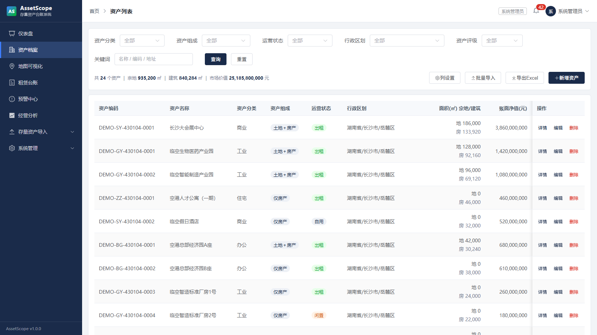

# AssetScope · 不动产运营工作台

**把一张乱糟糟的存量资产 Excel，变成能查、能算、口径自洽的资产台账系统。**

面向集团、城投、国企的不动产台账：脏表接入、字段适配、校验拦截、指标口径、盘活分析。

`免费使用` · `Windows 免安装` · `本地运行` · `不联网不上传`

**[下载最新版](https://github.com/tuolingyao/AssetScope-Public/releases/latest)** · [使用手册](docs/使用手册.md) · [常见问题](#常见问题) · [版本记录](CHANGELOG.md)

---


## 它解决什么问题

做资产台账的人大概都遇到过这些：

- 表头不在第一行——前面压着一行「（单位名称）房屋建筑物明细表」，或者表头跨三行合并
- 一个格子里写多个值：「土地使用权证、房产证」，拆不开就没法做权证到期预警
- 面积写成「约 500」「500 ㎡」「500 平方米」，日期写成「2010年6月」
- 下拉框挂错列：「建筑质量」的下拉挂到了「土地出让金」上
- 区划写「省/市/区」三级全称，也写「市/区」，也写区名，甚至写 `/`、`—`、`N/A`
- 同一家单位有三种写法

直接把表读进 Excel 库，得到的数据看起来能用，实际上全错——而且**不会报错**。

AssetScope 的设计前提是：**静默错位比报错危险得多**。所以它会把「认不出」的地方全部显式报出来，让你在入库前逐条确认。

## 三步开始

1. 下载 [`AssetScope-v1.1.0-win64.zip`](https://github.com/tuolingyao/AssetScope-Public/releases/latest)（约 49 MB）
2. 解压到任意目录
3. 双击 **`AssetScope.exe`**，浏览器自动打开

首次启动会自动构建演示库，约 5 秒。**不需要安装 Node.js、数据库或任何运行环境。**

解压后只有一个入口，其余都收在 `app/` 里，不用分辨该点哪个：

```
AssetScope/
├── AssetScope.exe     ← 双击这个
├── 快速开始.txt
└── app/               ← 程序本体（Node 运行时、后端、前端）
```

`AssetScope.exe` 只是一层启动外壳，真正干活的是 `app/start.bat`——
若它被杀毒软件误删，直接双击 `app/start.bat` 效果完全相同。

> 启动后会有一个黑色命令行窗口。**它不是报错**：AssetScope 在本机跑一个服务，
> 浏览器只是它的显示器。关窗口即停服务，窗口里的文字也是出问题时唯一的线索，
> 所以刻意没有隐藏它。

| 演示账号 | 密码 | 角色 |
|---|---|---|
| `admin` | `admin123` | 系统管理员 |
| `zcgl` | `123456` | 资产专员 |
| `yyzl` | `123456` | 运营专员 |
| `ceng` | `123456` | 分管领导 |

> 首次登录后请修改 `admin` 密码。软件只监听 `127.0.0.1`，不对外提供访问。

## 导入模板长什么样

「下载导入模板」拿到的是**四张数据表 + 一张填写说明 + 一张隐藏字典**，不是只有一行表头：

| Sheet | 列数 | 放什么 |
|---|---|---|
| Sheet1 资产 | 27 | 资产自身属性：名称 / 分类 / 来源 / 运营状态 / 使用现状 / 区划 / 地址 / 归属企业 / 核算科目… |
| Sheet2 土地组件 | 25 | 一块地一行：宗地面积、用途、容积率、年限及截止日、是否划拨、权证与权利人 |
| Sheet3 房产组件 | 22 | 一栋房一行：建筑面积、可租面积、建筑类型、楼层、建成年份、车位、权证与权利人 |
| Sheet4 经营与账务 | 10 | 经营收入、其他费用、累计折旧、账面净值、市场价值、租赁价值、年折旧摊销、利息支出、所得税率 |
| Sheet0 填写说明 | — | 8 条总则 + 逐字段的必填性 / 类型 / 单位 / 精度 / 示例 / 填报要求 + 常见错误 |
| `_字典`（隐藏） | 18 | 下拉选项的来源，用户看不到，改它下拉就空了 |

- **枚举列是下拉、数值列限精度与下限、日期列限区间**，填错的当格就会被 Excel 拦下，不用等导入才发现
- 每个表头都带批注，写清必填性、数据类型、精度与示例
- 经营数据**整表一个年度**：填在 Sheet4 右上角 `B1`，一次导一年。换成「一行一年」会让 5000 条资产变成几万行，填报和核对都没法做
- 四张表用「Sheet1资产」第一列关联；那一列**只用于关联**，正式编码入库时由系统按「公司码4+分类码2+区划码6+顺序号4」生成（要保留自己的编号，填到「备注」列）

## 能做什么

| 环节 | 做了什么 |
|---|---|
| **接入** | 系统自带四表模板（含填写说明与下拉），按表头文字认列；表头对不上就报出来，不按位置硬读 |
| **校验** | 24 条规则（5 条阻断 / 19 条提示），覆盖枚举、日期、数值、区划、跨行一致性 |
| **适配** | 84 个字段自动落到 10 个详情页签；认不出的列在核对页手工对应 |
| **口径** | 面积三口径互不覆盖、空值≠0、出租率按面积加权、NOI / 坪效统一出口 |
| **建档** | 资产（实体）+ 组件（土地/房屋），表达纯土地、纯房产、混合体 |
| **分析** | 仪表盘、区域分布、业态三分、盘活分析、预警中心（7 类规则） |




### 校验到底怎么判

举三个真实场景，看它和「读进来就行」的区别：

**区划三分**
写「浙江省杭州市萧山区」→ 能分析出落位，提示；
写「浙江省长沙市岳麓区」→ 省市矛盾，**阻断**；
写 `/`、`—`、`N/A`、空白 → **阻断**（不是默认放过）。

**占位符按空**
样例模板里的 `****.**`、`*年*月` 是占位，不是 0，也不是「无」。
两者必须分开处理——合成一个判据会把「没填」误判成「填了 0」，均值直接失真。

**枚举三类处置**
字典里没有的档，只有三条路：补字典、归一别名、按未填报。
三者互不替代——「工业用房」和「厂房」看起来近义，但在地价体系里不是一回事，
直接归一等于篡改数据。

## 关于数据

- **全程离线**：软件不联网、不上传、不校验授权、不含遥测。
  断开网络（甚至拔掉网线）可以照常使用——这是最快的验证方式。
- **数据在你自己机器上**：单文件 SQLite，位于 `app/backend/data/assetscope.db`。
- **备份方法**：停止服务后，把 `app/backend/data/` 整个目录复制走。
  该库使用 WAL 模式，会同时存在 `-wal`、`-shm` 两个伴生文件，**三个一起拷**才是完整备份。
- **地图底图**：使用天地图在线服务。内网无法访问时，空间数据页签显示空白，不影响其他功能。

## 常见问题

**为什么不开放源代码？**

这套系统的价值集中在四千行左右的规则判据上——区划怎么三分、枚举怎么三类处置、
跨行一致性怎么判、指标口径为什么这样定。这些不是通用编程技巧，而是长期做不动产台账
攒下来的判断，也是这个项目主要的技术投入所在。

界面问题、需求建议、使用报错都非常欢迎反馈——这些不需要看源码也能说清楚。

**能接入我们自己的表吗？**

能。导入时系统会推断表头、识别列、映射字段，认不出的列会列在核对页让你手工对应。
表结构和内置模板差异很大时，可以先导出列映射、调整后再导入。

**支持 Mac / Linux 吗？**

当前发行包是 Windows 免安装版。程序本身跨平台，其他平台支持在计划中。

**数据量大能撑住吗？**

实测过万行级、同名址重复的台账，导入与查询正常。SQLite 单文件在几十万行量级内表现良好。

**升级会覆盖我的数据吗？**

不会。数据在 `app/backend/data/`，升级只替换程序文件。
**但升级前请先备份 `app/backend/data/` 整个目录。**

**能在多台电脑上装吗？**

可以，不限实例数。每台电脑的数据各自独立。

## 系统要求

- Windows 10 / 11，64 位
- 磁盘空间 120 MB
- 内存 2 GB 以上
- 解压路径建议不含特殊符号（避免命令行解析问题）

## 反馈

提 Issue 时请说明三件事，能大幅提高定位效率：

1. 你的表**长什么样**（脱敏后发几行，或说明表头在第几行、有几个合并单元格）
2. 卡在**哪一步**（导入 / 核对 / 入库 / 查看）
3. 完整报错信息或截图

## 许可

免费使用，**非开源**。个人及组织内部使用免费，不限资产条数与用户数；
禁止转售、反编译与去除署名。详见 [LICENSE](LICENSE)。

Copyright (c) 2026 tuolingyao. All rights reserved.
